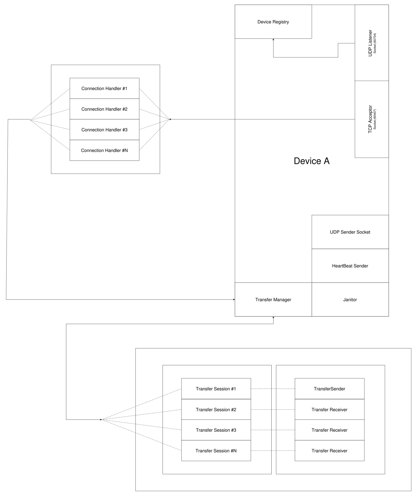

# LanSHA

<p align="center">
<strong>Fast, lightweight and secure LAN file sharing built from scratch.</strong>
</p>

<p align="center">

</p>

<p align="center">
Automatic device discovery • Reliable TCP transfers • Java Swing UI • Cross-platform
</p>

---

## Overview

LanSHA is a desktop application for sharing files directly between devices on the same local network. It uses UDP for discovery and heartbeat traffic, then switches to TCP for reliable file transfer. The project is deliberately implemented from first principles so the networking, protocol, and UI layers are easy to study and extend.

The current implementation includes:

- Automatic LAN device discovery
- Device registry and heartbeat monitoring
- Reliable peer-to-peer file transfer
- Swing-based transfer UI with file preview panels
- Basic metadata extraction for common file types
- Settings persistence for device identity and port configuration

---

## Project documentation

The repository includes a set of architecture diagrams and reference documents under the docs folder:

- [Architecture guide](docs/architecture.md)
- [Protocol specification](docs/protocol.md)
- [Developer guide](docs/developer-guide.md)
- [FAQ](docs/faq.md)

The visual assets in [docs/Images](docs/Images) include the core architecture, protocol, and communication-flow diagrams used throughout the documentation.

---

## Current implementation status

Implemented

- [x] UDP device discovery and discovery replies
- [x] Heartbeat and janitor-based device lifecycle management
- [x] TCP-based file transfer workflow
- [x] Swing user interface for device selection and transfer handling
- [x] File metadata preview for images, audio, video, and documents
- [x] Device registry and transfer session management

Planned or in progress

- [ ] End-to-end AES encryption
- [ ] SHA-256 based integrity verification
- [ ] Resumable transfers
- [ ] Drag-and-drop file sending
- [ ] Expanded theme support

---

## Getting started

### Requirements

- Java 21 or newer
- Maven
- NetBeans or any Java IDE with Maven support

### Clone the repository

```bash
git clone https://github.com/Knovengel-Nova/LanSHA.git
cd LanSHA
```

### Build

```bash
mvn clean package
```

### Run

You can run the application from the generated jar:

```bash
java -jar target/LanSHA-1.0.jar
```

Or launch the main class from your IDE using the entry point in [src/main/java/com/amasp/lansha/LanSHA.java](src/main/java/com/amasp/lansha/LanSHA.java).

---

## Architecture at a glance

LanSHA is organized into the following layers:

- UI layer for the desktop experience
- Network layer for UDP/TCP services and transfer coordination
- Protocol layer for packet definitions and serialization
- Device and metadata utilities for registration and file inspection

A complete description of the design is available in [docs/architecture.md](docs/architecture.md).

---

## License

This project is licensed under the MIT License. See [LICENSE](LICENSE) for details.

---

## Contact

If you have feedback, ideas, or would like to contribute, feel free to open an issue or get in touch through the project repository.
